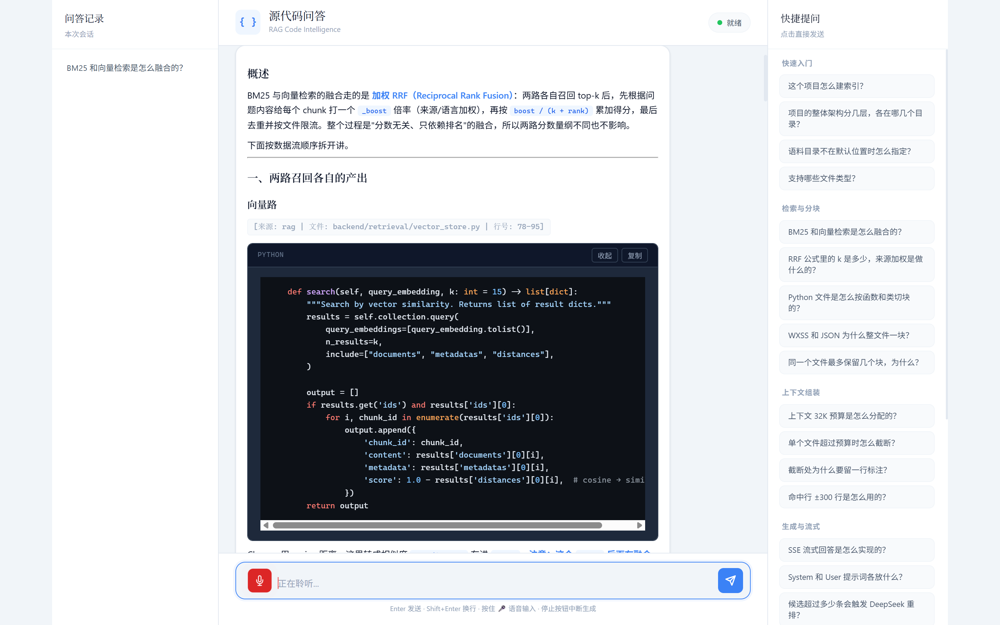

# 代码库问答系统（RAG for source code）

把一份源码仓库灌进索引，然后用中文提问：「这个项目怎么建索引」「BM25 和向量怎么融合」。检索按函数/类边界定位，回答时喂给模型的是**完整文件**，不是切碎的片段。

**一句话差异**：代码类文件按结构边界切块，不按固定字符数切；检索同时跑语义和精确两条路；上下文以整文件为单元，而不是 top-k 碎片。

<p align="center">
  
  
  
</p>

<sub>真实运行截图（同一会话）：语料为本仓库自身源码，索引 35 个文件 / 177 个块。</sub>

## 定位

单机代码问答 demo：一份源码目录、一个本地嵌入模型、一个 API Key，起一个进程回答问题。查询表与索引句柄都在进程内存里，没有鉴权、没有多进程共享状态，适合本机、单用户、中小体量语料。

> **安全边界**：默认只监听 `127.0.0.1`（全链路无鉴权，CORS 仍为 `*`）。要在局域网提供服务，显式设置 `RAG_HOST=0.0.0.0`，并自行补上鉴权、CORS 白名单与反向代理限流——否则同网段任何人都能读取索引里的源码片段、消耗你的 DeepSeek 额度。

## 架构与检索流程

```
POST /api/rag/query → query_id → GET /api/rag/query/stream/{id}（SSE）
  查询扩展：160 组中英术语映射（可选 LLM 扩展，默认关）
  ├ 向量检索：Chroma + jina-embeddings-v2-base-code（Ollama，768 维）
  ├ 关键词检索：rank-bm25（中英混排分词，标识符不拆）
  └ RRF 融合：1/(60+rank) + 来源/语言加权 → 去重 → 同文件最多 3 块
  → 上下文组装：按 RRF 排名补全整文件（32K 预算，超出按命中行 ±300 行截断）
  → DeepSeek 流式生成 → SSE → 前端打字机渲染（Markdown + 高亮 + 折叠/复制）
```

技术栈：FastAPI + uvicorn（SSE）｜Chroma 向量 + rank-bm25｜jina-embeddings-v2-base-code｜DeepSeek Chat｜原生 JS（marked / DOMPurify / highlight.js）。
目录：`backend/`（indexing / retrieval / generation / routes / asr）· `frontend/` · `tests/` · `docs/` · `run.py` · `build_index.py`。

## 快速开始

```bash
python -m venv .venv && .venv\Scripts\activate && pip install -r requirements.txt
ollama pull unclemusclez/jina-embeddings-v2-base-code:q5
set DEEPSEEK_API_KEY=sk-...        # PowerShell: $env:DEEPSEEK_API_KEY="sk-..."
python build_index.py full && python run.py   # http://127.0.0.1:8001/frontend/index.html
```

语料默认取 `data/source-main/`；不在默认位置时用 `RAG_SOURCE_DIRS="标签=路径;…"` 或 `build_index.py --source-dirs` 覆盖。索引是本地生成物，仓库不附带 `data/`，首次使用需自行构建。

## 测试

```bash
pip install -r requirements-dev.txt   # 运行依赖 + pytest + ruff
pytest -q                             # 不装模型、不配 Key 也能跑
ruff check .
```

当前 **57 passed**，CI 在 ubuntu 上跑 Python 3.10 / 3.11 / 3.12。离线单测覆盖分块边界、检索融合、上下文预算、SSE 心跳与路由装配；`tests/test_e2e_smoke.py` 用本仓库源码 + 假向量跑通「建索引 → 双路检索 → RRF → 组装上下文」。设计报告见 [docs/DESIGN.md](docs/DESIGN.md)，逐轮修复清单见 [docs/CHANGELOG.md](docs/CHANGELOG.md)。

## License

MIT © 2026 zhangjingtong000
