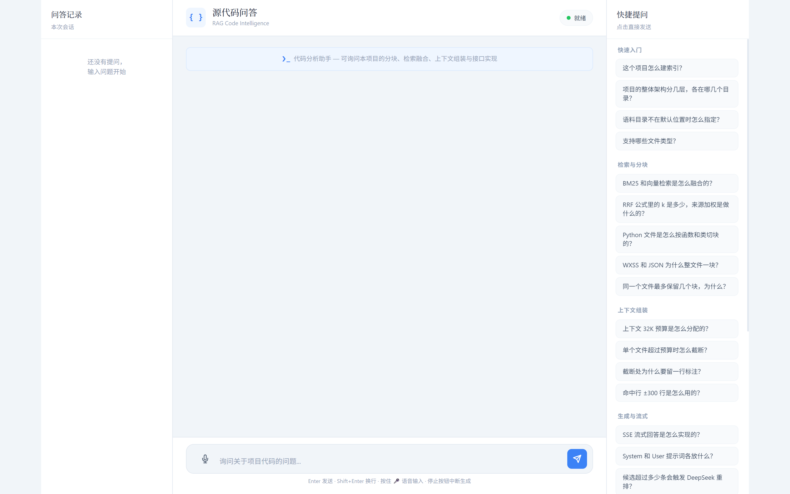

# 代码库问答 RAG

把一份源码目录灌进索引，然后用中文提问：这个接口怎么实现、BM25 和向量怎么融合。检索按函数/类边界定位，回答时喂给模型的是整份文件。

<p align="center">
  
  
  
</p>

<sub>截图取自同一会话，语料为本仓库自身源码，截图时索引 35 个文件 / 177 个块。</sub>

## 它做什么

建索引时按函数、类、组件边界切块，每块附一句语义标签；提问后同时跑向量检索（jina-embeddings-v2-base-code，768 维）和 BM25 关键词检索，两路排名用 RRF 融合；排在前面的文件整份读进上下文，超出 32K token 预算时按命中行 ±300 行截断；DeepSeek 流式生成，前端边收边渲染。

```text
POST /api/rag/query              → query_id
GET  /api/rag/query/stream/{id}  → SSE：metadata → token… → done
  查询扩展  160 组中英术语映射（LLM 扩展默认关）
  双路召回  向量 k=25 + BM25 k=25
  融合      1/(60+rank) + 来源/语言加权 → 去重 → 同文件 ≤3 块
  上下文    按 RRF 排名补全整文件，32K 预算，命中行 ±300 行截断
  生成      DeepSeek 流式输出，前端打字机渲染
```

## 快速开始

```bash
python -m venv .venv
.venv\Scripts\activate                  # macOS/Linux: source .venv/bin/activate
pip install -r requirements.txt
ollama pull unclemusclez/jina-embeddings-v2-base-code:q5
set DEEPSEEK_API_KEY=sk-...             # PowerShell: $env:DEEPSEEK_API_KEY="sk-..."
python build_index.py full --source-dirs "rag=."   # 用本仓库自身源码建索引
python run.py                            # 打开 http://127.0.0.1:8001/frontend/index.html
```

默认语料是 `data/source-main`、`data/source-release`、`data/source-rag` 三个目录；语料在别处时用 `RAG_SOURCE_DIRS="标签=路径;…"` 或 `--source-dirs` 指过去。索引是本地生成物，仓库不附带 `data/`，首次使用要自己构建。

不开浏览器也能问：

```bash
curl -X POST http://127.0.0.1:8001/api/rag/query \
  -H "Content-Type: application/json" \
  -d '{"question":"BM25 和向量怎么融合"}'
# 返回 query_id 与 stream_url，再 GET stream_url 取 SSE 事件流
```

## 功能

| 能力 | 说明 |
| --- | --- |
| 问答界面 | 三栏布局，Markdown 渲染 + 代码高亮，代码块可折叠、可复制，生成中可中断 |
| 双路检索 | 向量与 BM25 同时召回，RRF 融合；候选超过 15 条时用 DeepSeek 重排 |
| 索引管理 | 全量 / 增量构建，增量只重新嵌入改过的文件，BM25 语料每次全量重建；页面顶栏显示构建状态 |
| 多轮对话 | 携带最近 10 条问答历史，历史长度与输入预算一起计算 |
| 语音输入 | 按住麦克风说话，松开后文字填进输入框（需另装 ASR 后端） |
| HTTP 接口 | `POST /api/rag/query` 取 query_id，`GET /api/rag/query/stream/{id}` 走 SSE，静默 15 秒发一次心跳 |

## 设计要点

**结构感知切块**：Python 按 `def`/`class` 断，类里再按方法细分；JS 认 `function`/`class` 以及 `var X = class` 这类表达式；HTML/WXML 在 `<template>`、`<view class>` 边界处断，小文件整份一块；CSS/WXSS 和 JSON 整文件一块（JSON 只进 BM25）。同一切块在两套索引里共用一个 `chunk_key`，RRF 不会把同一块当成两条结果。

**整文件上下文 + 预算截断**：检索只负责挑出相关文件，进上下文的仍是完整文件，最多 4 个。32K 预算按 RRF 排名依次装文件，单个文件超过 20K token 时保留命中行 ±300 行并留下截断标记。第一个文件就超预算时也会收一段截断内容，不返回空上下文。

**RRF 与来源加权**：两路排名按 `1/(60+rank)` 相加；问题里出现 rag、main/release 分支、前端或接口关键词时，对相应来源和语言乘 1.3–2.0。同一文件最多保留 3 块，把位置让给别的文件。

**可选语音**：浏览器录 16kHz 单声道 WAV，`POST /api/rag/audio/transcribe`，后端起子进程调用本机 Qwen3-ASR，支持 qwen3-asr-cli、qwen-asr 包、antirez 的 C 二进制三种后端并自动探测，录音上限 30 秒。

## 已知边界

- 单机 demo：查询表和 BM25 缓存都在进程内存里，按单用户、中小语料设计。
- 没有鉴权，默认只监听 `127.0.0.1`；要对外服务得显式设 `RAG_HOST=0.0.0.0`，并自行补鉴权、CORS 白名单和限流。
- 检索依赖 Ollama 里的 `jina-embeddings-v2-base-code:q5`，问答依赖 DeepSeek API Key，少一样就只跑得通半条链路。
- 语音输入要另装 ASR 后端，没装时 `/audio/transcribe` 返回 503。
- 160 组中英术语映射、加权倍数、项目背景（`backend/semantic_tags.json`）都是给本仓库配的，换技术栈要改 Python 和这份 JSON。

换项目时用 `RAG_SOURCE_DIRS`（或 `--source-dirs`）指向新语料，再改 `backend/semantic_tags.json` 里的项目背景与文件语义标签。

## 技术栈

Python 3.10+ · FastAPI + uvicorn（SSE）· Chroma + rank-bm25 · jina-embeddings-v2-base-code（Ollama）· DeepSeek Chat · 原生 JS + marked / DOMPurify / highlight.js。

## 目录结构

```text
backend/
  indexing/    扫描、切块、嵌入、索引编排
  retrieval/   向量库、BM25、RRF 融合、重排、查询扩展
  generation/  上下文组装、提示词、DeepSeek 流式调用
  routes/      query / health / audio 三组接口
  asr/         Qwen3-ASR 子进程封装
frontend/      三栏界面、SSE 接收、Markdown 渲染
tests/         离线单测，不依赖模型和 Key
docs/          DESIGN.md（设计报告）、CHANGELOG.md（逐轮修复）、截图
build_index.py 索引构建入口
run.py         服务入口
```

## 测试

```bash
pip install -r requirements-dev.txt   # 运行依赖 + pytest + ruff
pytest -q                             # 57 passed，不需要模型和 API Key
```

离线单测覆盖分块边界、检索融合、上下文预算、SSE 心跳和路由装配；`tests/test_e2e_smoke.py` 用本仓库源码加假向量跑通「建索引 → 双路检索 → RRF → 组装上下文」。设计细节见 [docs/DESIGN.md](docs/DESIGN.md)，逐轮修复见 [docs/CHANGELOG.md](docs/CHANGELOG.md)。

## License

MIT © 2026 zhangjingtong000
